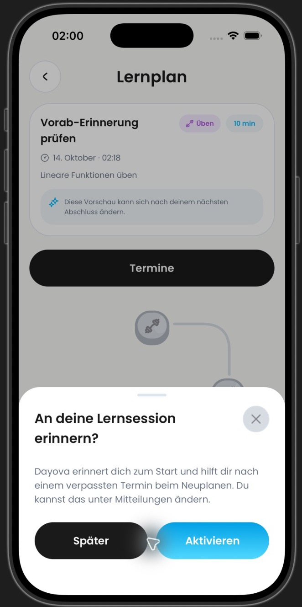
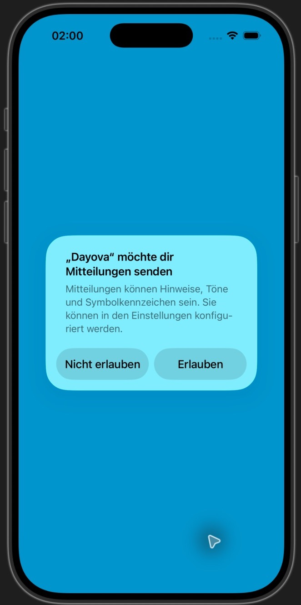
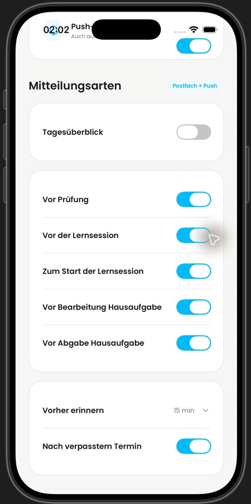
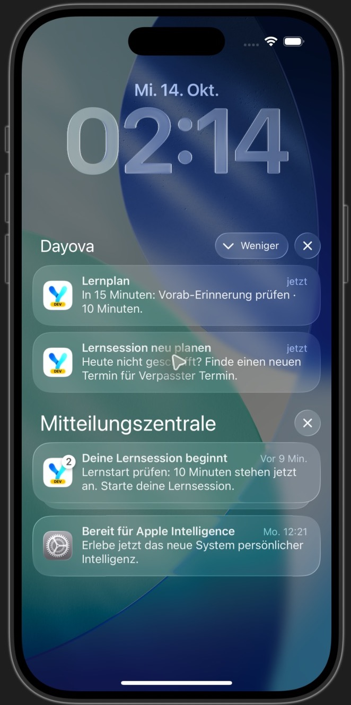
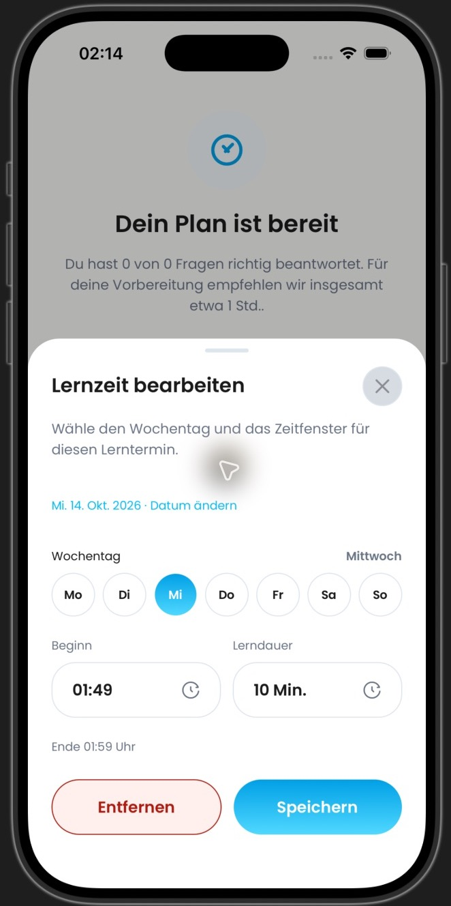
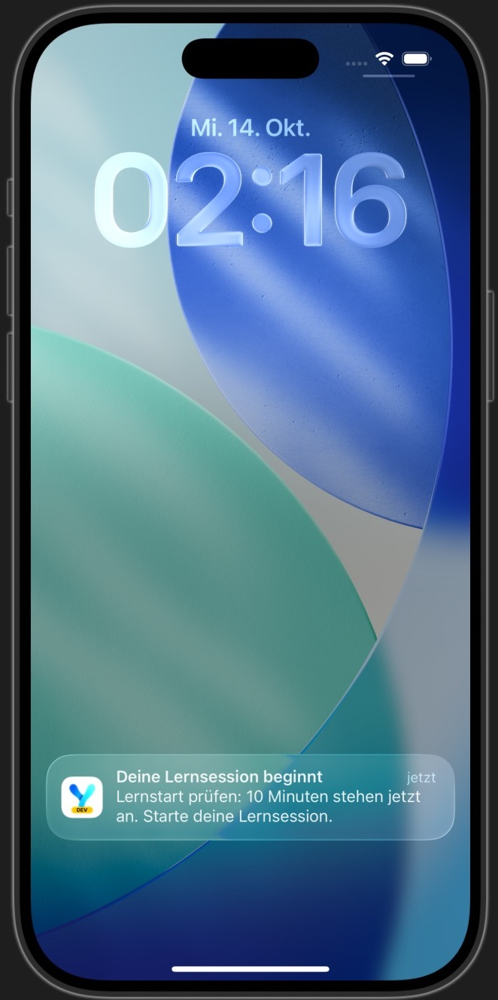
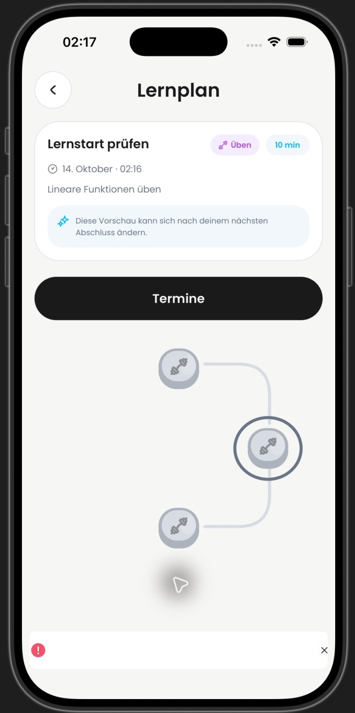

# DAY-486: vollständige App auf iOS

Test am 14. Oktober 2026, Europe/Berlin, im vom Auftraggeber ausgewählten Simulator **Dayova Main 12.10 – Neuer Account** (iPhone 17 Pro, iOS 26.4.1). Getestete Feature-Version: `994531a15e7e4972877a11ea6de7d05a9594782d`. Integration-Basis: `dc59a02bdb481b306a0f42854b5b27531d893b25` (`main` beim Test).

## Aufbau

Vollständiger Dayova-Development-Build mit unverändertem App-Einstieg, echtem Clerk-Login, echtem Router und isoliertem lokalem Convex-Backend. Drei synthetische Lerntermine wurden dort über einen temporären internen Seed angelegt. Keine gemockten UI-Komponenten, keine injizierten Push-Nachrichten und keine vorgezogene Systemuhr. iOS hat die durch die App geplanten lokalen Notifications selbst zugestellt.

Ein temporärer lokaler Testzugang ersetzt den Kauf-/Trial-Ablauf. Die Testtermine sind vorläufige Vorbereitungsslots ohne KI-generierte Lerninhalte. Die vollständige Planerstellung, Diagnosefragen und KI-Inhaltsgenerierung sind deshalb **nicht** Teil dieses Nachweises. Beim abschließenden Start-Tap wurde die KI-Einwilligung nach ausdrücklicher Freigabe für das lokale Testkonto erteilt. Der vorläufige Testslot wurde von der Inhaltsgenerierung abgelehnt (siehe unten). Das gemeinsam genutzte Dev-Backend konnte den PR wegen abweichender Schemafelder nicht laden; der erfolgreiche Test erfolgte ausschließlich lokal. Produktion wurde nicht verändert.

Die ersten drei Bilder entstanden auf `5b9b8ad6`; deren dargestellte UI ist auf `994531a1` unverändert. Die Wiederholung der Zustellung und Navigation erfolgte nach der unten beschriebenen iOS-Korrektur. Bilder sind echte Simulator-Aufnahmen, auf den Geräterahmen zugeschnitten.

## Berechtigung und Einstellungen

Das Angebot im Lernplan öffnet die echte iOS-Berechtigungsabfrage. „Später“ und „Aktivieren“ bleiben einzeilig. Vorab-Reminder wurden für den Test aktiviert, der Vorlauf beträgt 15 Minuten. Start- und Rückkehr-Reminder sind aktiviert, Tagesüberblick ist aus.

| Angebot im Lernplan | iOS-Berechtigung | Mitteilungseinstellungen |
| --- | --- | --- |
|  |  |  |

## Tatsächliche Zustellung und Navigation

| Fall | Testtermin | Soll-Zustellung | Beobachtung |
| --- | --- | --- | --- |
| Vorab | 02:29–02:39 | 02:14 | iOS zeigt „In 15 Minuten: Vorab-Erinnerung prüfen · 10 Minuten.“ |
| Verpasst | 01:49–01:59 | 02:14 | iOS zeigt „Lernsession neu planen“; Tap öffnet direkt den Editor für 01:49–01:59. |
| Start | 02:16–02:26 | 02:16 | iOS zeigt „Deine Lernsession beginnt“; Tap selektiert „Lernstart prüfen“, 02:16. |

| Vorab und verpasster Termin | Geöffneter Termin-Editor | Start-Reminder |
| --- | --- | --- |
|  |  |  |

[Ungekürzte Simulator-Aufzeichnung: verpasster Termin → Editor](missed-to-editor.mp4). Beide Kontaktbögen der vollständigen Laufzeit wurden geprüft: 00:00–00:06 zeigt die beiden aktuellen Notifications; 00:06.5 beginnt der Wechsel zur App; 00:07 zeigt die Termine; 00:09 zeigt den passenden Editor (01:49, 10 Minuten) ohne Fehlerbanner. Der Film ist ein Navigationsnachweis, keine Messung der realen Wartezeit bis zur Zustellung. Kein Audio/keine Transkription. Zwischen den Stichproben können kurze Zustände liegen.

Verbatim coverage: **Coverage: 9.66-second video; 19 full-timeline frames sampled at 2 fps (0.5-second interval); 2 contact sheet(s); no audio stream.**

Beim Start-Tap wurde der richtige Lernpfad-Knoten ausgewählt. Nach Zustimmung versucht die bestehende Lernplanseite jedoch, Inhalte für den synthetischen vorläufigen Slot anzufordern. Das Backend lehnt ihn mit „Dieser Lernblock ist nur eine Vorschau und kann sich noch ändern.“ ab. Der folgende Screenshot lässt den zugehörigen Entwicklungs-Fehlerhinweis bewusst sichtbar. Damit ist **Zustellung und Auswahl**, aber keine erfolgreiche KI-Lerneinheit nachgewiesen.

## Im Test gefundene und korrigierte Regression

Expo 57 liefert auf iOS den Zustellzeitpunkt in Unix-Sekunden. Die bisherige Verarbeitung interpretierte ihn als Millisekunden, wodurch die Historien-Mutation ein Datum im Jahr 1970 ablehnte. `994531a1` normalisiert beide Formate. Der neue Regressionstest schlug vor der Korrektur fehl und besteht danach. 25 gezielte Tests, TypeScript und Biome bestanden; unabhängiges Review ohne Befund.

## Grenzen der Abnahme

Dieser Nachweis betrifft lokale OS-Notifications im iOS-Simulator. Er belegt weder APNs/Server-Push noch ein physisches iPhone oder Android. Kaltstart nach Prozessbeendigung, native Änderung/Löschung ausstehender Notifications und die subjektive Hilfreichkeit/Rückkehr nach Julius' Demo bleiben gesondert abzunehmen. DAY-486 wird durch diese Evidenz allein nicht als vollständig abgenommen markiert.
