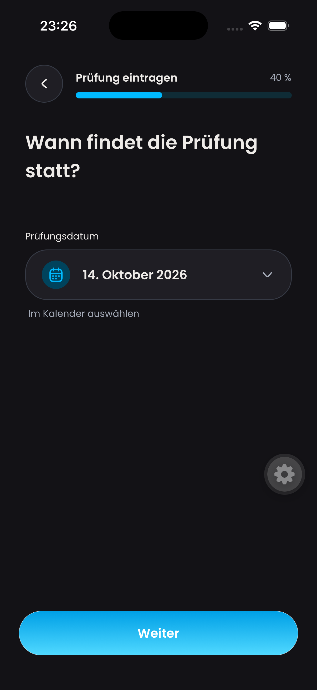
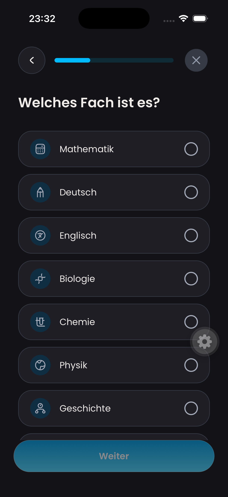
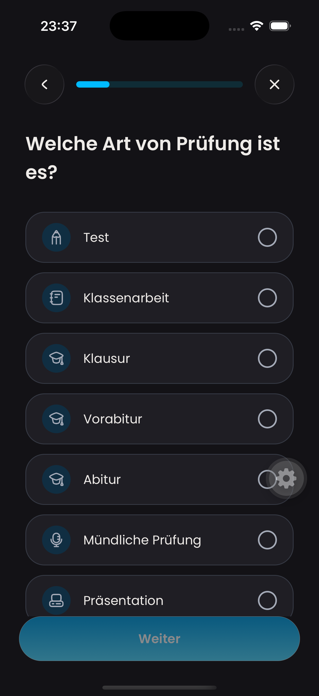

# Learning-plan creation header validation

Captured on 14 October 2026 in the iPhone 17 Pro simulator, iOS 26.5,
dark appearance, 1206 × 2622 pixels. Updated UI: commit `cbaf534a`.
The PNGs are unmodified simulator captures.

| Before: exam date | After: subject selection |
| --- | --- |
|  |  |

The screens show different steps of the same creation flow. Compare the shared
header layout, not the step content or progress value. The before capture was
taken at 23:26 CEST before reloading the updated app; the after capture was taken
at 23:32 CEST with the updated app.

The after image confirms that the back and close controls flank a centered
progress bar, with no visible header title or percentage. Screen content retains
its own heading. The floating gear is the Expo development tools control.

These still images establish visual layout only. The implementation's 38
passing targeted tests cover progress, back/close dispatch, disabled close,
exam exit, return to a saved exam, and draft pause behavior. Native close
navigation was not confirmed because simulator automation was unreliable.

## Native Liquid Glass follow-up

Captured at 23:37 CEST on the same iPhone 17 Pro / iOS 26.5 simulator after
relaunching the development app. This is the final iOS header appearance;
`after-subject-selection.png` records the earlier layout before the glass request.
Both controls are Expo UI native SwiftUI Buttons with `buttonStyle("glass")`,
circular borders, and Dayova's existing icons. The effect is subtle against the
uniform dark background. Older iOS uses native bordered buttons; Android/web
keep the existing shared controls. No blur imitation or new dependency is used.

The screenshot verifies native rendering, icon visibility, spacing, and absence
of header text. Automated coverage exercises native-boundary callbacks and the
disabled close state; manual native interaction remains unverified because the
simulator control service did not reliably target the active window.
