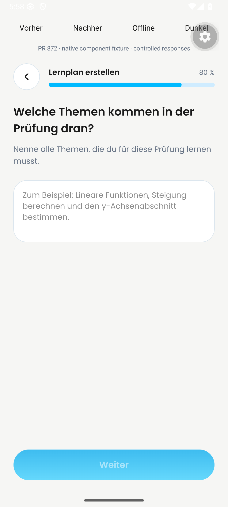
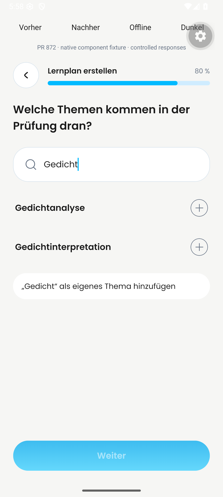
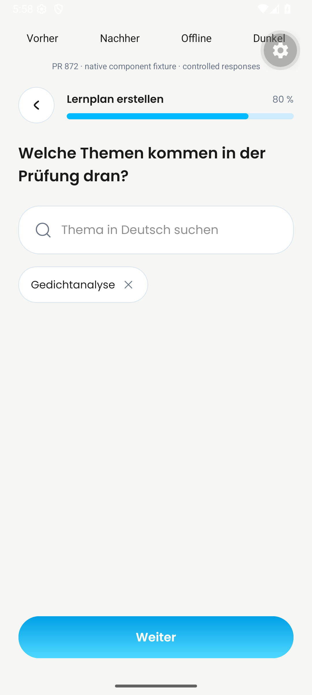
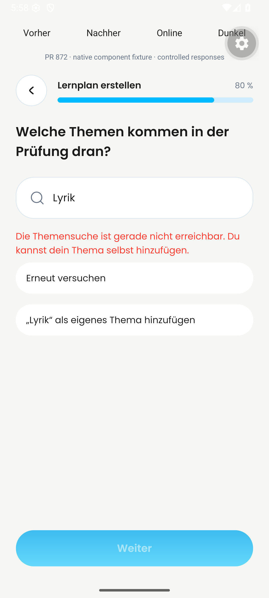
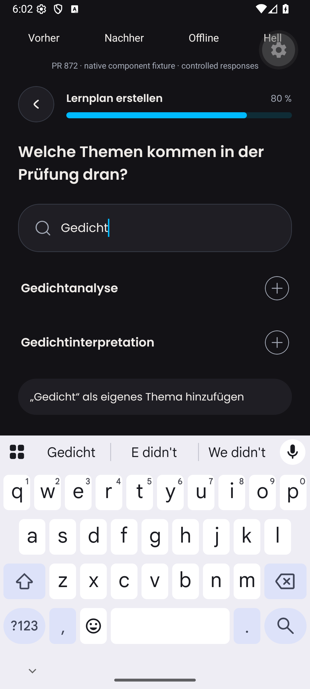
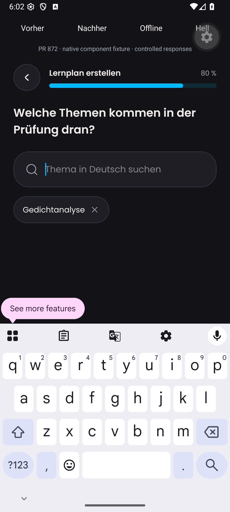
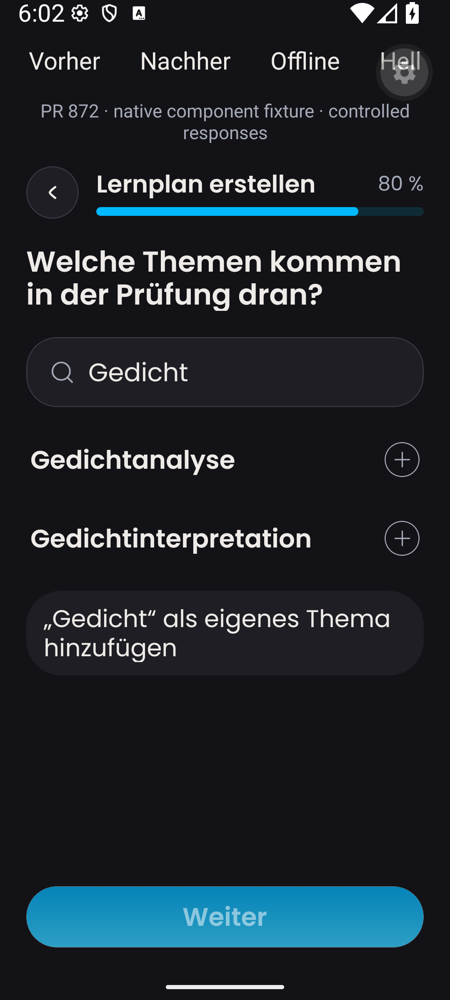

# Android before/after validation — 16 October 2026

Captured in the local `Dayova_PR836` Android 16 emulator, 1080×2400 pixels,
density 420, using the installed Dayova development client. These are native
production-component fixtures with controlled search responses, clearly labeled
in every capture. They do not establish Clerk authentication, a deployed Convex
action, live WLO responses, or complete route navigation.

The original recovered iPhone captures and recording in [README.md](README.md)
are preserved separately, including their original limitations.

## Before / after

| Before — manual topics | After — searchable topics |
| --- | --- |
|  |  |

| Selected topic | Provider failure with recovery |
| --- | --- |
|  |  |

| Dark search with keyboard | Dark selected topic with keyboard |
| --- | --- |
|  |  |

The 1.5 font-scale capture shows complete wrapping of the custom-topic action
and visible search results. The fixture's separate control strip and developer
gear are not product UI. This is a single enlarged-text case, not exhaustive
maximum-text, tablet, or screen-reader validation. Android may recreate the
activity after changing font scale; the screenshot was taken after re-entering
the query. The default font scale was restored afterward.

## Recording and timeline coverage

[Watch the continuous before/after interaction](android-before-after.mp4).

This is the first 48.5 seconds of an 81.37-second device recording, resized to
720×1600 for playback. Time is not accelerated; no stages are stitched together.
The excluded tail contains developer-tool interaction and fixture resets. The
complete source and final export were both inspected across their full timelines.

- 0–9s: the production base component's manual textarea.
- 10–13s: switch to the updated component and enter `Gedicht`.
- 14–24s: prepared search results are visible.
- 25–35s: `Gedichtanalyse` is selected and Continue is enabled.
- 36–38s: remove the selected chip and enter `Lyrik` with failure simulation.
- 39–48s: the shared inline error, retry action, and custom-topic action remain
  available. The final export establishes availability of the fallback, not a
  completed live-provider recovery or persisted plan.

Coverage: 81.37-second video; 81 full-timeline frames sampled at 1 fps (1-second interval); 6 contact sheet(s); no audio stream.

Coverage: 48.51-second video; 49 full-timeline frames sampled at 1 fps (1-second interval); 4 contact sheet(s); no audio stream.

All six source sheets and all four export sheets were inspected. The four export
contact sheets are retained under [inspection](inspection). No audio stream;
transcription is not applicable. One-second sampling establishes the sequence,
not frame-by-frame smoothness or sub-second timing. Screenrecord uses variable
frame rate, so this is not evidence of animation frame rate.

## Source and reproduction

The before component was extracted from
`src/features/learning-plans/learning-plan-setup-steps.tsx` at `origin/main` and
verified equal to the PR merge-base `b3273956`; both have Git blob
`e00f397c81d5ad344521a76b3c59451869156b3a`.

The after component is implementation `7c956b9c` plus the reviewed shared
`ErrorMessage` accessibility fix. The captured `topic-search.tsx` has SHA-256
`E91ADB25C6E64AF2155FB8F93CA6994AEA0FD00B7669319F2212492F82354A8F`.
The incoming `ddc634f6` commit only adds original iPhone evidence and was
fast-forwarded without altering the captured source.

The exact temporary harness is saved as
[capture-fixture.tsx.txt](capture-fixture.tsx.txt). To reproduce, copy it to
`.tmp/pr872-fixture.tsx`, extract the base setup component to
`.tmp/before-steps.tsx`, and temporarily register that fixture from `index.ts`.
It mounts the actual setup components and theme providers; only search responses
and route callbacks are controlled. The two suggestions are deliberately
prepared data. The failure toggle throws locally; it does not disconnect a
production service. Restore the original entry point after capture. No fixture
entry point is included in app code.

## Fresh validation

Node 24.18.0, frozen branch dependencies:

- 38 focused UI tests passed across topic search, setup, and creation flow.
- 10 WLO/description validation unit tests passed.
- TypeScript and changed-file Biome checks passed.
- Error recovery retains the shared alert role, polite live region, selectable
  text, retry, and custom-topic entry.

Authenticated end-to-end validation, a live provider request from the app,
physical devices, and manual VoiceOver/TalkBack remain outstanding. The fixture
comparison complements the original iOS evidence; it does not satisfy an
actual-route base/head recording requirement.
