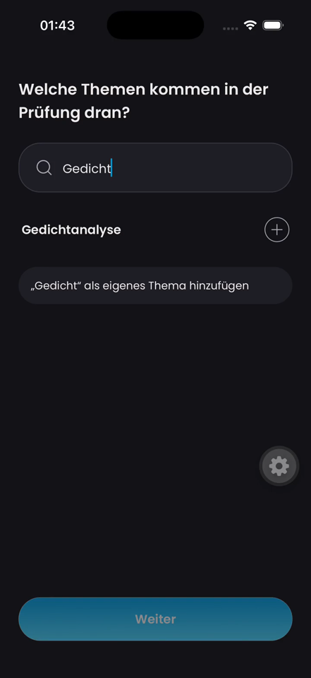
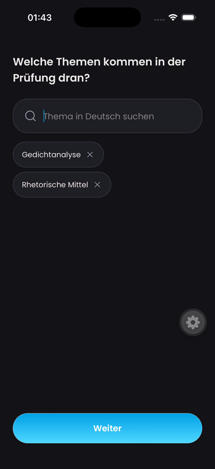

# Topic-search screenshot evidence

Recovered on 16 October 2026 from the original 15 October 2026, 01:43 CEST simulator demo. iPhone 17 Pro, dark appearance; isolated production-component preview with prepared search responses. The demo was recorded after implementation commit `7c956b9c`; it does not establish an authenticated route or live WLO response. The exact runtime revision was not embedded in the original recording.

| Search result (5s) | Selected topics (22s) |
| --- | --- |
|  |  |

These PNGs are unretouched extracted video frames, scaled by the inspection tool to 441×960. The source recording is 720×1566. The floating gear is the Expo development tool.

[After recording](topic-search-final.mp4)

## Complete-timeline inspection

All four contact sheets were inspected. At 0s the search is empty; at 4.5s Gedichtanalyse is offered for Gedicht; at 10s it appears as a selected chip; at 15s Rhetor yields two suggestions; at 21s two selected chips are visible; at 24.5s only Gedichtanalyse remains. These observations describe a prepared-response demo, not provider latency or end-to-end navigation.

Coverage: 26.08-second video; 52 full-timeline frames sampled at 2 fps (0.5-second interval); 4 contact sheet(s); no audio stream.

No transcription applies. Half-second sampling cannot establish frame-by-frame smoothness or exact sub-half-second interaction timing.

## Remaining handbook evidence

[Developer handbook evidence checklist](https://app.notion.com/p/3dc2e87228bf81c69e43cadf318c2d9f) requires before/after screenshots and recordings on the actual base/head. No verified base screenshot or base recording was recovered for this PR. This after-only fixture evidence is partial, not full compliance. Android, light mode, enlarged text, authenticated flow and exact-base/head recapture remain unverified.
